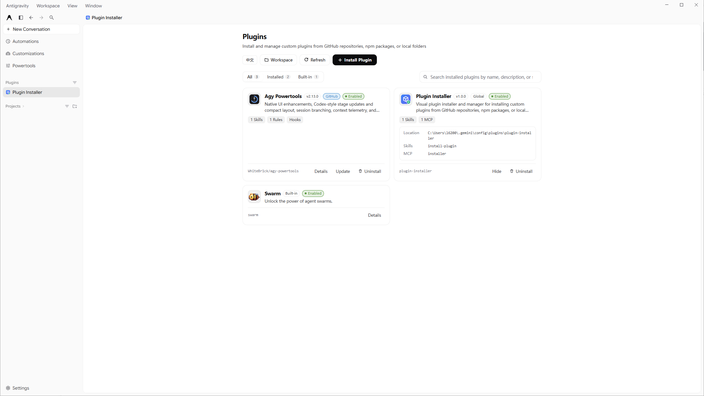
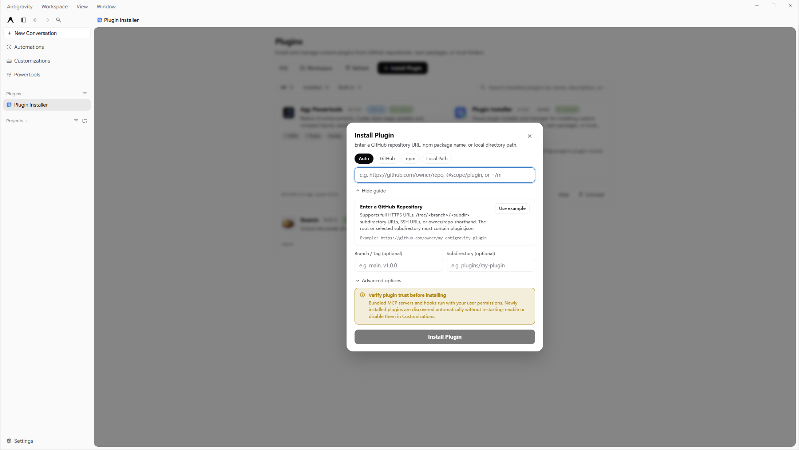

# Plugin Installer for Antigravity

English | [简体中文](./README.zh-CN.md)

An Antigravity plugin powered by an integrated **MCP App** that lets you install and manage custom plugins directly from **GitHub repositories**, **npm packages**, or **local directories** inside an interface styled to match the Antigravity App.

## Screenshots

### Plugin Manager Overview



### Install Plugin Modal



## Features

- **Native Antigravity UI Integration (MCP App)**:
  - Registers as a full-page entry in the left sidebar (**Plugin Installer**) and as an auxiliary side pane tab (`aux_pane`), plus inline rendering when triggered from chat.
  - Automatically inherits Antigravity's Light/Dark theme tokens (`--color-background-*`, `--color-text-*`, `--color-border-*`, `--font-sans`) and host locale (`English` / `简体中文`, with one-click toggle).
- **One-Click `Install Plugin` Modal**:
  - Smart auto-detection for **GitHub URLs** (`https://github.com/owner/repo`, `/tree/<branch>/<subdir>`, SSH, `owner/repo`), **npm packages** (`pkg`, `@scope/pkg@version`, `npmjs.com` URLs), and **local directories** (absolute, `~/`, or quoted paths).
  - Switchable npm registries (**npm Official**, **npmmirror**, or custom `https://` registry).
  - Local install modes: **Copy files** (isolated) or **Symlink / Junction** (macOS/Linux live dev link).
  - Collapsible format guide with one-click example insertion, branch/subdirectory fields, install scope selection (**Global** `~/.gemini/config/plugins` or **Workspace** `<workspace>/.agents/plugins`), and conflict overwrite protection.
- **Installed Plugin Management**:
  - View global, workspace, and built-in plugins with component badges (`Skills`, `MCP`, `Agents`, `Rules`, `Hooks`), manifest validation notices, one-click reinstall/update from recorded source metadata, and safe uninstall (protects built-in plugins and never edits `config.json`).
- **Zero Runtime Dependencies**:
  - The MCP server runs purely on Node.js (`>= 18.18.0`) built-in modules, so cloning or installing the plugin works out of the box without running `npm install`.

## Installation

### Option 1: Using Antigravity CLI (`agy`)

```bash
agy plugin install https://github.com/yedanten/antigravity-plugin-installer
```

### Option 2: Manual Global Install

Clone this repository directly into your global Antigravity plugins directory:

- **macOS / Linux**:
  ```bash
  git clone https://github.com/yedanten/antigravity-plugin-installer.git ~/.gemini/config/plugins/plugin-installer
  ```
- **Windows (PowerShell)**:
  ```powershell
  git clone https://github.com/yedanten/antigravity-plugin-installer.git "$env:USERPROFILE\.gemini\config\plugins\plugin-installer"
  ```

### Option 3: Local Development Sync (Recommended on Windows & Cross-Platform)

Run the bundled local sync script from this repository to install a clean copy into `~/.gemini/config/plugins/plugin-installer` (without copying `node_modules` or `.git`):

```bash
npm run install:local
```

> **Note for Windows**: Antigravity's plugin scanner skips Windows directory junctions (`ReparsePoint`) under `~/.gemini/config/plugins/`. Use `npm run install:local` after making changes to sync your working copy cleanly. On macOS / Linux, symlinks also work:
> ```bash
> ln -s /path/to/antigravity-plugin-installer ~/.gemini/config/plugins/plugin-installer
> ```

Antigravity automatically discovers newly added plugins without a restart.

## Usage

1. **Sidebar / Auxiliary Pane**: Click **Plugin Installer** in the Antigravity App left sidebar (or open it from the side pane `+` menu).
2. **Install a Plugin**: Click **`+ Install Plugin`** at the top right, paste a GitHub URL, npm package name, or local directory path, adjust options if needed, and click **Install Plugin**.
3. **Slash Command / Chat**: Invoke `/install-plugin` in chat or ask the agent to open the Plugin Installer or install a specific plugin URL directly.
4. **Enable / Disable Plugins**: Newly installed plugins are enabled by default and hot-discovered by Antigravity. To toggle enable/disable state, use Antigravity's native **Customizations** page.

## Configuration

The bundled MCP server (`mcp_config.json`) requires no secrets or manual configuration and supports the following optional environment variables:

| Variable | Description |
| :--- | :--- |
| `ANTIGRAVITY_PLUGINS_DIR` | Override the default global plugins directory (`~/.gemini/config/plugins`). |
| `ANTIGRAVITY_BUILTIN_PLUGINS_DIR` | Override the built-in plugins directory scanned as read-only. |
| `PLUGIN_INSTALLER_APP_HTML` | Point to a custom HTML file path for rapid UI iteration. |

## Development & Building

The MCP server (`server/*.mjs`) runs directly with Node.js without a build step. If you modify the MCP App UI under `ui/`:

```bash
# Install dev dependencies (Vite, TypeScript, @modelcontextprotocol/ext-apps)
npm install

# Typecheck and rebuild the single-file UI bundle (assets/app.html)
npm run typecheck
npm run build

# Run unit and end-to-end MCP stdio tests
npm test

# Validate plugin manifest & structure strictly
npm run validate:plugin

# If Antigravity CLI is installed:
agy plugin validate --strict .
```

## License

[MIT](./LICENSE)
