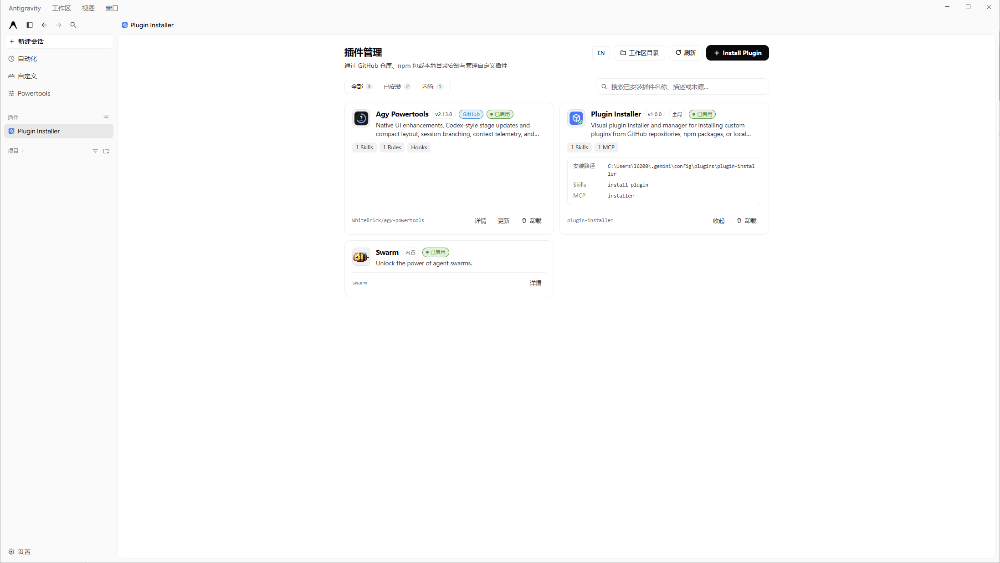
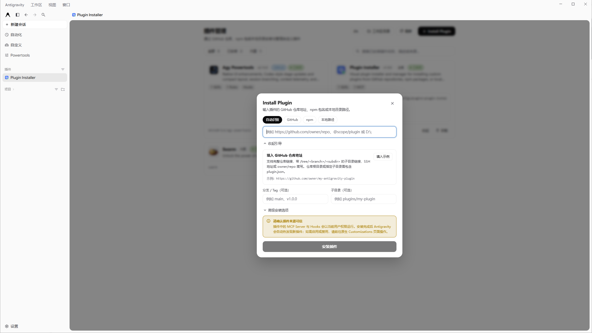

# Antigravity 插件安装器（Plugin Installer）

[English](./README.md) | 简体中文

一款基于 Antigravity **MCP App** 能力构建的可视化插件安装与管理扩展，提供与 Antigravity App 原生风格一致的界面，支持直接输入 **GitHub 仓库地址**、**npm 包名** 或 **本地目录路径** 一键安装与管理自定义插件。

## 效果预览

### 插件管理主界面



### Install Plugin 安装弹窗



## 核心特性

- **原生风格融合（MCP App）**：
  - 同时注册为左侧导航栏独立全屏页面（**Plugin Installer**）与右侧辅助面板标签页（`aux_pane`），也支持在对话中通过斜杠命令内嵌唤起。
  - 自动继承 Antigravity 宿主的明/暗主题变量（`--color-background-*`、`--color-text-*`、`--color-border-*`、`--font-sans`）与语言环境（支持中/英双语自动识别与右上角一键切换）。
- **一键 `Install Plugin` 弹窗**：
  - 智能识别三类插件来源：**GitHub 地址**（支持完整仓库 URL、`/tree/<branch>/<subdir>` 子目录链接、SSH 地址及 `owner/repo` 简写）、**npm 包名**（支持普通包、作用域包 `@scope/pkg@version` 与 `npmjs.com` 链接）及 **本地目录路径**（支持绝对路径、`~/` 与带引号路径）。
  - npm 支持切换安装源（**npm 官方源**、**npmmirror 国内镜像源** 或自定义 `https://` Registry）。
  - 本地安装支持 **复制安装**（推荐，独立拷贝文件）或 **开发软链接**（macOS/Linux 实时联调）。
  - 内置可折叠格式引导与“填入示例”按钮、分支/子目录选项、全局/工作区安装范围切换，以及同名插件冲突一键覆盖重试。
- **已安装插件管理**：
  - 统一展示全局、工作区与内置插件，呈现图标、版本、来源标签、组件统计徽章（`Skills`、`MCP`、`Agents`、`Rules`、`Hooks`）与清单校验提示。
  - 支持基于来源记录的一键 **更新 / 重装** 与带二次确认的安全 **卸载**（严格保护内置插件，绝不手改 `config.json`）。
- **零运行时依赖**：
  - MCP Server 完全基于 Node.js（`>= 18.18.0`）原生模块实现，克隆或安装后无需执行 `npm install` 即可开箱即用。

## 安装方式

### 方式一：通过 Antigravity CLI（`agy`）安装

```bash
agy plugin install https://github.com/yedanten/antigravity-plugin-installer
```

### 方式二：手动克隆到全局插件目录

将本仓库直接克隆到 Antigravity 的全局插件目录：

- **Windows（PowerShell）**：
  ```powershell
  git clone https://github.com/yedanten/antigravity-plugin-installer.git "$env:USERPROFILE\.gemini\config\plugins\plugin-installer"
  ```
- **macOS / Linux**：
  ```bash
  git clone https://github.com/yedanten/antigravity-plugin-installer.git ~/.gemini/config/plugins/plugin-installer
  ```

### 方式三：本地开发同步安装（Windows 及跨平台推荐）

在仓库根目录运行内置同步脚本，即可将当前工作区的运行文件干净地同步到 `~/.gemini/config/plugins/plugin-installer`（自动跳过 `node_modules` 和 `.git`）：

```bash
npm run install:local
```

> **Windows 提示**：Antigravity 在 Windows 上扫描 `~/.gemini/config/plugins/` 时会跳过目录联接（Junction / `ReparsePoint`）。本地二次开发后请使用 `npm run install:local` 同步测试；macOS / Linux 下也可使用符号链接：
> ```bash
> ln -s /path/to/antigravity-plugin-installer ~/.gemini/config/plugins/plugin-installer
> ```

安装完成后 Antigravity 会自动发现该插件，无需重启应用。

## 使用说明

1. **打开界面**：点击 Antigravity 左侧栏中的 **Plugin Installer**（或从右侧辅助面板 `+` 菜单打开）。
2. **安装插件**：点击页面右上角 **`+ Install Plugin`** 按钮，粘贴 GitHub 地址、npm 包名或本地插件目录路径，按需调整分支、子目录、镜像源或安装范围后点击 **安装插件**。
3. **对话唤起**：在聊天中输入 `/install-plugin`，或直接让 Agent 打开插件安装器 / 安装指定插件地址。
4. **启用与禁用**：新安装的插件默认自动启用并热加载；如需启用或禁用插件，请前往 Antigravity 原生 **Customizations（自定义）** 页面操作。

## 可选环境变量

插件自带的 MCP Server（`mcp_config.json`）无需密钥或额外配置，同时支持以下可选环境变量：

| 变量名 | 说明 |
| :--- | :--- |
| `ANTIGRAVITY_PLUGINS_DIR` | 自定义全局插件目录路径（默认 `~/.gemini/config/plugins`）。 |
| `ANTIGRAVITY_BUILTIN_PLUGINS_DIR` | 自定义只读扫描的内置插件目录路径。 |
| `PLUGIN_INSTALLER_APP_HTML` | 指向自定义 HTML 路径，便于开发 UI 时热重载调试。 |

## 本地开发与构建

服务端（`server/*.mjs`）可由 Node.js 直接运行，无需编译；如修改了 `ui/` 目录下的前端源码：

```bash
# 安装开发构建依赖（Vite、TypeScript、@modelcontextprotocol/ext-apps）
npm install

# 类型检查并重新打包单文件 UI（输出到 assets/app.html）
npm run typecheck
npm run build

# 运行单元测试与 MCP stdio 端到端测试
npm test

# 严格校验 plugin.json 与插件结构
npm run validate:plugin

# 如本机安装了 Antigravity CLI，也可运行官方校验：
agy plugin validate --strict .
```

## 开源协议

[MIT](./LICENSE)
